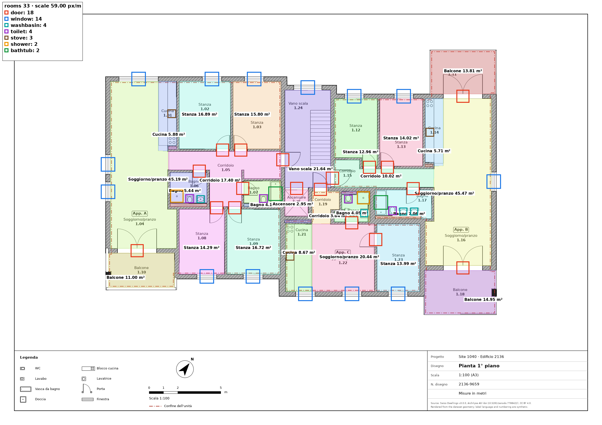

# Floor plans: room segmentation + symbol detection (Junction 2026, Stoa)

From a floor-plan image to answers about room areas and item counts, with each answer traced back to what was found on the drawing.

Each part of the job goes to the model that suits it:

| Part | Model | File |
|---|---|---|
| Room interiors (outlines → areas) | U-Net, resnet34, 1-channel, trained on full-resolution crops | `train_unet.py`, `seg_predict.py` |
| Doors, windows, toilets, washbasins, bathtubs, showers, stoves | YOLO11s on 640-px tiles; each detection counted once (ownership merge) | `yolo_train.py`, `seg_predict.py` |
| Room labels, numbers, apartments, printed areas, rough scale | one language-model call (Gemini) | `gemini_policy.py` |
| Precise scale | the drawing's own scale bar, measured in pixels | `scale_bar.py` |
| Rooms joined through open doorways | split at the doorway neck | `seg_post.py` |
| Answers + Stoa's scoring (counts exact, areas within 2%) | deterministic code | `answer.py`, `env.py` |



*Swiss test plan site1040, never seen in training: segmented rooms with measured areas, plus detected symbols. Detected vs true: 33/33 rooms, doors 18/20, windows 14/14, washbasins 4/4, toilets 4/4, stoves 3/3, bathtubs 2/2, showers 2/2. Drawing: Swiss Dwellings (Archilyse AG, CC BY 4.0, doi:10.5281/zenodo.7788422).*

## Results so far (Sat 14 Nov, 14:45)

On 115 Swiss test plans, scored by Stoa's rule:

| | Gemini 3.8 Flash alone | This pipeline |
|---|---|---|
| Mean reward | 0.587 | **0.877** |
| Area questions | 38.9% | **79.3%** |
| Count questions | 74.5% | **89.2%** |
| Item counts exact | 40% | **75%** |

- Areas need the scale to within about 1%. A language model's own reading of the scale has a median error of 0.94%; measuring the scale bar brings 109 of 115 plans within 0.5%.
- The detector rarely reports something that isn't there (precision about 0.97), but it misses items (recall about 0.66), so counts tend to come out low. Choosing a lower confidence cut-off is in progress.
- **CubiCasa (messy, low-resolution plans) doesn't work yet.** Those images are about 400×600 px, so symbols are only a few pixels across. The fix, upscaling small images ×4 for both training and prediction, is training now (round 8 in `modal_app.py`). The Gemini baseline there is 0.53 reward, with 52% of item counts exact.

## Draw it on any plan
```bash
python3 viz.py --image plan.png --pred seg_preds/plan.json --labels results/gemini_single_gemini-3.8-flash/plan.json --out plan_viz.png
```

## Train / predict / score (Modal)
```bash
modal deploy modal_app.py
python3 launch.py round8                      # data → U-Net + YOLO in parallel → predictions → scores, all in the log
python3 launch.py score /vol/seg_preds split_bar
python3 launch.py log | tail -40
```
- Data: `seg_data.py` (masks + YOLO tiles; small images are upscaled).
- CubiCasa labels: `cubi_gt.py` converts the official CubiCasa5k SVG annotations (doors, windows and bedrooms match Stoa's answers 100%). `cubi_fit.py` checks which class names Stoa counted.

The dataset, ground-truth JSONs, model weights and results are **not** in this repo (licences, size). API keys come from environment variables only.
